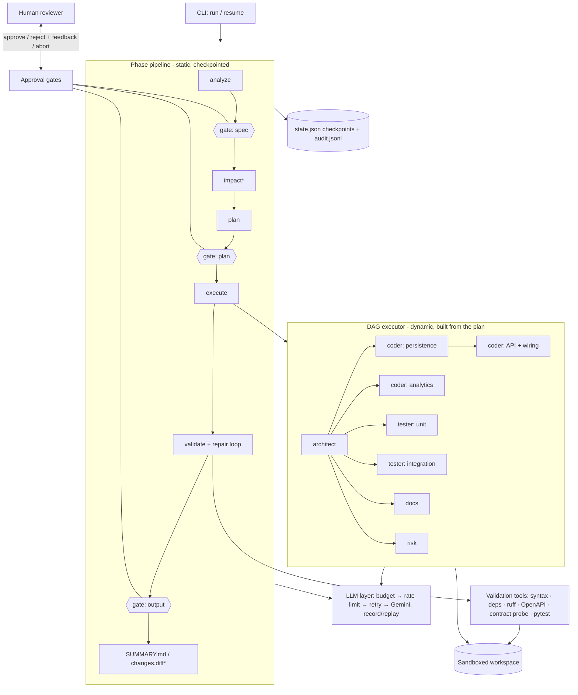

# Architecture

This document covers the system components, the execution model and control flow, and the key
technical decisions with their trade-offs. [`DESIGN.md`](DESIGN.md) is the original approved
design; this document describes what was built.

## 1. System overview

`*` = brownfield only.

## 2. Components

| Layer | Component | Responsibility |
|---|---|---|
| Orchestration | `orchestrator/pipeline.py` | Static phase sequence, human gates, replanning, validation/repair loop, reports |
| | `orchestrator/dag.py` | Dependency-aware parallel execution of the planner's task graph |
| | `orchestrator/gates.py` | `CliGate` (interactive), `AutoApproveGate` (CI), `ScriptedGate` (tests) |
| | `orchestrator/state.py`, `checkpoint.py` | Typed run state (shared blackboard); atomic checkpoint after every step |
| | `orchestrator/summary.py` | Deterministic `SUMMARY.md` from run state |
| Agents | `agents/planning.py` | **Requirement Analyst** (spec + ambiguities), **Planner** (task DAG) + domain plan rules |
| | `agents/impact.py` | **Codebase Analyst**: impact of a change on an existing repo (brownfield) |
| | `agents/workers.py` | **Architect**, **Coder**, **Tester**, **Docs**, **Risk**; `TaskRouter` dispatches DAG tasks |
| | `agents/review.py` | **Reviewer** (root cause + fault attribution) and `RepairCoordinator` |
| | `prompts/*.md` | Role prompts; `conventions.md` is the binding contract shared by all code-producing agents |
| LLM | `llm/base.py` | Provider-agnostic `LLMClient` interface and error taxonomy (transient / permanent / budget) |
| | `llm/gemini.py` | Gemini adapter (`google-genai`), JSON-schema-constrained output |
| | `llm/resilient.py` | Decorator: per-run budget → rate limiter → retries with exponential backoff + jitter → audit |
| | `llm/structured.py` | Typed calls: parse into Pydantic; on failure feed validation errors back for self-correction |
| | `llm/replay.py`, `llm/fake.py` | Record/replay cassettes (offline, deterministic); scripted client for tests |
| Tools | `tools/sandbox.py` | Workspace-confined file I/O (no traversal/symlink escape, no secret files, size cap) |
| | `tools/runner.py` | Allow-listed subprocess execution (`pytest`, `ruff`, contract probe), scrubbed env, timeout |
| | `tools/checks.py`, `validation.py` | The validation checks, run concurrently |
| | `tools/code_index.py` | AST repository map: symbols, signatures, FastAPI routes, import graph |
| | `tools/repo.py` | Brownfield import (copy, skip secrets/caches/binaries) and unified diff |

## 3. Execution model and control flow

### Two orchestration layers

1. **Phase pipeline (static).** `analyze → approve_spec → impact → plan → execute → validate →
   approve_output`. Each phase is checkpointed; `agentforge resume <run-id>` skips completed phases.
2. **Task DAG (dynamic).** The Planner produces the task graph at runtime. The executor repeatedly
   starts every task whose dependencies have succeeded (bounded by `max_concurrency`), so
   independent tasks run in parallel. For the URL shortener a typical plan has the architect on the
   critical path, then 2-4 coder tasks (layered by imports), 2 tester tasks, docs and risk all fanning
   out in parallel.

### Cross-step coordination (not just sequencing)

- **Shared contract.** The architect's design (module interfaces with exact signatures, data model,
  OpenAPI contract) is the single source of truth. Coders implement it; testers test it, in
  parallel and independently (testers never see code). Disagreements surface as failing tests,
  which is exactly what the repair loop resolves.
- **Context flow.** Each task receives the outputs of its ancestors (e.g. a coder sees files written
  by the coder tasks it depends on) plus the list of tasks it runs alongside, so it knows which
  files belong to someone else.
- **File ownership.** Every write records its owning task. A task may only overwrite files of its
  own, its ancestors, or the imported repo; parallel tasks cannot clobber each other. Role path
  rules (coder: not `tests/`; tester: only `tests/`; docs: `README.md`/`docs/`) are enforced too. A
  violation fails the attempt and the error is fed back on retry.
- **Fault attribution.** After a failed validation, the reviewer decides whether the code, the tests
  or both deviate from the contract, and the `RepairCoordinator` runs code and test fixes in parallel.

### Error handling and recovery

| Failure | Handling |
|---|---|
| Rate limit / 5xx / timeout / empty response | Retry with exponential backoff + jitter (max 4), then fail the task |
| LLM output does not match the schema (incl. invalid OpenAPI) | Validation errors fed back to the model; up to 2 self-corrections |
| Planner produces an invalid DAG (cycle, unknown agent/dependency, missing architect/tester) | Automatic replan with the errors as feedback (max 2 revisions) |
| Task raises (bad output, ownership conflict, ...) | Task retried with the previous error in its prompt (max 2 attempts) |
| Task fails permanently | Its transitive dependents are skipped; independent branches continue; human gate offers retry / accept partial / abort |
| Non-retryable error (budget exhausted, replay miss) | Task fails immediately, no retry |
| Validation fails | Review → repair → re-validate, up to 3 rounds |
| Validation still failing | Output gate defaults to **abort** (fail-safe); a human may still accept or send feedback |
| Process interrupted | State checkpointed after every task/decision; `resume` continues where it stopped |
| Any phase crashes | Run marked `failed` with the reason; `SUMMARY.md` is still written |

### Controlled autonomy

Agents run autonomously between gates; humans decide at gates.

| Gate | Human sees | Choices |
|---|---|---|
| `spec` | Normalized requirement and open questions | Answer/accept defaults → approve; reject with feedback (re-analysis); abort |
| `plan` | Task graph by parallel step, rationale, impact analysis | Approve; reject with feedback (replan); abort |
| `execution_failures` | Task status table | Retry failed tasks; accept partial results; abort (default once retries are used) |
| `output` | Tasks, validation results, repair history, files | Approve; reject with feedback (another review/repair round); abort (default if validation failed) |

`--auto-approve` takes each gate's default action, which is always the safe one.

## 4. Guardrails

- **Sandbox**: all agent writes go through `Sandbox`; absolute paths, `..` and symlink escapes are
  rejected; `.env`, keys and credentials can be neither written nor read; 512 KB file cap.
- **Brownfield safety**: the repo is copied into the run; the original is never modified; secrets,
  caches and binaries are not imported (and therefore never sent to the LLM).
- **Execution**: generated code runs only via allow-listed modules in a subprocess with a scrubbed
  environment (no API keys), `HOME` set to the workspace, and hard timeouts.
- **Dependency allow-list**: generated code may import only the stdlib, local modules and an
  explicit package list; anything else fails validation.
- **Budgets and limits**: per-run LLM call and token budgets; caps on retries, replans, repair rounds.
- **Untrusted LLM output**: every response is schema-validated; plans are structurally validated
  before a human ever sees them.
- **Auditability**: `audit.jsonl` records every LLM call (agent, prompt hash, tokens, latency),
  task transition, validation round, verdict and human decision.

## 5. Key design decisions

| Decision | Alternatives | Rationale / trade-off |
|---|---|---|
| Custom asyncio orchestrator | LangGraph, CrewAI | The task graph is generated at runtime, which a custom DAG executor handles natively; every behaviour (parallelism, recovery, gates, resume) is explicit and testable. Cost: more code to own. |
| Two-layer orchestration (fixed phases + dynamic DAG) | One fully dynamic graph | Human gates and validation must always happen in a fixed order; the work in between varies by requirement. |
| Contract-first parallel code and tests | Tests written after code | Independent derivation catches real defects (tests written from the code tend to encode its bugs) and shortens the critical path. Cost: more repair rounds when the interfaces are ambiguous. |
| Deterministic validation (real tools) as the gate, LLM only for diagnosis | LLM-as-judge | Tool results are objective and reproducible; the LLM is used where judgment is needed (root cause, fix). |
| Fault attribution before repair | Always fix the code | Generated tests can be wrong too; the reviewer must not weaken them, and contract and design are the arbiter. |
| Structured outputs everywhere (Pydantic + JSON schema) | Free text parsing | Machine-checkable hand-offs between agents; validation errors become self-correction prompts. |
| Provider abstraction + record/replay | Direct SDK calls | Swap providers via config; deterministic offline demos and CI; replays cost no quota. |
| Gemini free tier (Flash) | Paid frontier models | Zero cost; the test-and-repair loop offsets weaker single-shot quality. Free-tier data may be used by Google, so only non-proprietary code is processed. |
| Target stack FastAPI + SQLAlchemy + SQLite, external services as interfaces | Postgres/Redis via Docker | Lets the system run the generated tests itself with zero setup; the design documents the production path (Postgres, Redis, queue-based analytics). |
| Deterministic `SUMMARY.md` from state | LLM-written summary | The summary reports what actually happened (statuses, validation results, decisions); it cannot hallucinate. |

## 6. Run state (blackboard)

`RunState` (`state.json`) holds: requirement, repo path, status, completed phases, normalized spec,
impact report, plan and revision count, per-task results (status, attempts, output, error,
timings), file ownership map, validation reports, repair rounds, gate decisions and metrics. It is
the only thing `resume` needs.

## 7. Extending

- **New provider**: implement `LLMClient.complete()` (about 50 lines; see `llm/gemini.py`) and wire it in
  `factory.build_llm`.
- **New agent role**: subclass `LLMAgent`, add a prompt, register it in `TaskRouter` and in the
  planner prompt's agent catalogue; add path rules in `ROLE_WRITE_RULES`.
- **New validation check**: add a function returning `CheckResult` to `tools/checks.py` and include
  it in `WorkspaceValidator`.
- **Different target stack**: edit `prompts/conventions.md`, the import allow-list and the contract
  probe.
